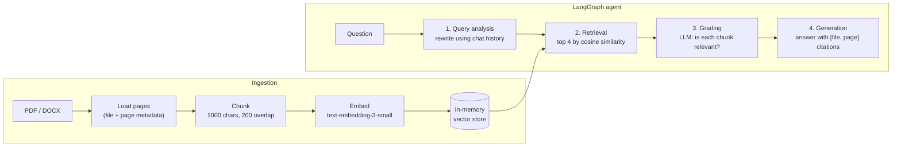

# StudyRAG: chat with your study documents

Upload lecture notes, papers or reports (PDF or DOCX) and ask questions about them in plain
language. StudyRAG answers from the documents only, cites the file and page for every claim,
says so when the documents don't contain the answer, and shows each step of its reasoning.

The project also includes a **robustness evaluation**: how the system behaves when the
knowledge base contains noise, false information, or sources that contradict each other.

M.Sc. course project: *Data Exploration and System Management*, winter semester 2025/26.

## How it works



1. **Query analysis**: the model rewrites the question for retrieval, resolving follow-ups
   from the conversation ("How does it differ from SGD?" becomes a full question about
   gradient descent).
2. **Retrieval**: the 4 chunks most similar to the rewritten query.
3. **Grading**: the model judges each chunk as relevant or not, and irrelevant chunks are
   dropped before answering.
4. **Generation**: GPT-4o answers from the remaining chunks and recent conversation, citing
   `[Source, Page X]`. With no relevant chunks it says it couldn't find the information
   instead of guessing.

The UI shows every step (the rewritten query, the grading decision for each chunk) and the
retrieved excerpts, so you can check where an answer came from. Conversation memory keeps
the recent turns and trims the oldest ones as the chat grows.

## Evaluation: how robust is it?

Three questions from the course material were asked against knowledge bases of increasing
difficulty, built from purpose-written documents ([`evaluation/`](evaluation/)).

| Level | Knowledge base | Correct | Partial | Abstained | Accuracy |
|---|---|---|---|---|---|
| 0 | Irrelevant text only | – | – | 3/3 | 100 % (correct abstention) |
| 1 | Ground truth only | 3/3 | – | – | 100 % |
| 2 | Ground truth + irrelevant noise | 3/3 | – | – | 100 % |
| 3 | Ground truth + noise + false information (1:1) | 1/3 | 2/3 | – | 33 % |
| 4 | Ground truth + noise + false information (1:2) | 1/3 | 2/3 | – | 33 % |
| 5 | Ground truth + contradicting sources (1:1) | 1/3 | 2/3 | – | 33 % |
| 6 | Ground truth + contradicting sources (1:2) | – | 3/3 | – | 0 % |

**What it does well:** it never hallucinated. With only irrelevant documents it abstained
every time, and it stayed fully accurate when noise was mixed in.

**Where it breaks:** as soon as false information enters the knowledge base, accuracy drops
to 33 %. Three failure modes explain it:

1. **Aggregation without filtering**: relevance grading checks the topic, not the truth, so
   false chunks pass and get merged into the answer.
2. **No authority ranking**: every source counts the same; nothing marks a document as more
   trustworthy.
3. **Conflict deferral**: with contradicting sources, it reports the disagreement instead of
   resolving it.

The fix this points to is **source credibility**: per-document trust scores, contradiction
detection between retrieved chunks, and answers that say which source they follow.

## Tech stack

| Part | Technology |
|---|---|
| Agent workflow | LangGraph (state graph with 4 nodes) |
| LLM / embeddings | OpenAI GPT-4o, text-embedding-3-small (via LangChain) |
| Retrieval | LangChain `InMemoryVectorStore`, `RecursiveCharacterTextSplitter` |
| Documents | pypdf, python-docx |
| UI | Streamlit |
| Tests | pytest, with a scripted fake LLM and fake embeddings (no API calls) |

## Run it

Python 3.11+ and an OpenAI API key.

```bash
python -m venv .venv
.venv/Scripts/pip install -r requirements.txt   # macOS/Linux: .venv/bin/pip
cp .env.example .env                            # then add your OPENAI_API_KEY
.venv/Scripts/streamlit run app.py
```

Open http://localhost:8501, upload documents in the sidebar, and ask away.

## Tests

```bash
.venv/Scripts/python -m pytest
```

12 tests cover document loading and page metadata, chunking, memory trimming, settings
validation, and the full agent pipeline (rewrite → retrieve → grade → answer) run against a
scripted model.

## Project layout

```
app.py                 Streamlit app: sidebar, chat, sources and agent steps
components/            chat and sources UI
src/
  rag_agent.py         LangGraph agent: query analysis, retrieval, grading, generation
  document_loader.py   PDF/DOCX loading with page numbers, chunking
  vector_store.py      in-memory vector store with OpenAI embeddings
  memory.py            conversation memory with trim-first-N
  config.py            settings from .env
evaluation/            robustness test: protocol, results, test documents
tests/
```

## Limitations

- The vector store lives in memory, so documents must be uploaded again after a restart.
- Scanned PDFs need OCR, which isn't included.
- One user per running app.
- The answer is shown word by word once it is complete, not streamed from the model.

## License

MIT. See [LICENSE](LICENSE).
