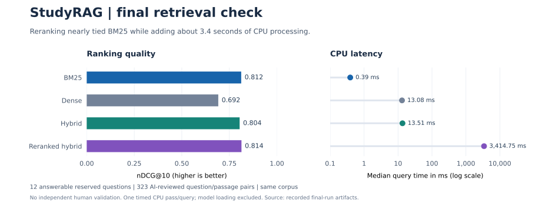
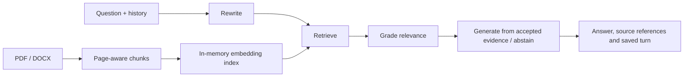

# StudyRAG

**Document assistant with LangGraph, plus reproducible retrieval evaluation.**

[](https://github.com/ghefarshalhoup/studyrag/actions/workflows/ci.yml)

StudyRAG answers questions about PDF/DOCX documents using retrieved context and source references. Its separate evaluation suite compares BM25, dense search, hybrid search and cross-encoder reranking—and checks whether a development gain survives reserved questions and its latency cost.

[Engineering case study](docs/CASE_STUDY.md) · [Final findings](evaluation/pilot/runs/heldout-metrics-v1/FINDINGS.md) · [Demo walkthrough](docs/DEMO.md)

## Engineering focus

- **Explicit state and failure handling:** rejected evidence stays rejected; no accepted evidence yields a deterministic abstention; completed answers are saved before a completion event is emitted.
- **Reproducible retrieval:** shared source-traceable chunks, pinned local models, stable ranking, fixed configuration, saved vectors/logits and offline replay.
- **Evaluation beyond a headline score:** development/final question separation, explicit relevance judgments, nDCG/MRR, latency and concrete regressions.
- **Inspectable evidence:** source lines, supporting excerpts, file/code hashes and tests that reject incomplete or stale evaluation artifacts.

## Final result: added complexity did not clearly pay off



Reranking improved development nDCG@10 from **0.788 to 0.844**, but nearly tied BM25 on the reserved questions: **0.814 versus 0.812**. BM25 placed direct evidence first on **9/12** answerable reserved questions; reranked hybrid did so on **7/12**, with roughly **3.4 seconds** of added CPU processing per query.

The final check used 16 reserved questions: 12 answerable and four missing-detail cases. All 323 pooled question/passage pairs have explicit **AI-reviewed** grades. This is a small, prospective same-corpus holdout without independent human validation; it measures retrieval, not answer accuracy. [Full results, formulas and limits](evaluation/pilot/runs/heldout-metrics-v1/REPORT.md).

## Try it without an API key or model download

Verified with **Python 3.13 on Windows CPU**. From a fresh checkout:

```powershell
python -m venv .venv
.\.venv\Scripts\python.exe -m pip install -r requirements-dev-lock.txt
.\.venv\Scripts\python.exe examples/offline_agent_demo.py
.\.venv\Scripts\python.exe -m evaluation.run_holdout --verify
.\.venv\Scripts\python.exe -m evaluation.score_holdout --output local-results/final-metrics
.\.venv\Scripts\python.exe -m pytest tests evaluation/pilot/test_dataset.py
```

The demo exercises the actual graph with a **scripted model and fake embeddings**; it checks behavior, not model quality. The evaluation replay uses **saved real model vectors/logits** and checks all 640 final ranked results. No paid API or inference is used by these commands. Use a fresh scoring output directory. [Recorded demo output](docs/assets/offline-demo.txt).

For evaluation replay alone, `requirements-eval.txt` installs just NumPy. The full development snapshot above also supports the app and tests. Optional local inference setup is in [the embedding guide](evaluation/SEMANTIC_COMPARISON.md) and [reranker guide](evaluation/RERANKER.md).

## Run the interactive assistant

Using the same environment, copy `.env.example` to `.env` and set your own `OPENAI_API_KEY`:

```powershell
Copy-Item .env.example .env
.\.venv\Scripts\python.exe -m streamlit run app.py
```

Upload a PDF/DOCX, ask a question, and inspect the source excerpts and workflow events. Interactive mode uses the configured OpenAI models and sends document text to that API. Live API generation is separate from the offline checks.

## Architecture



The app uses a linear LangGraph workflow and top-4 in-memory retrieval. The four-method retrieval experiment is a separate evaluation path; it does not replace the interactive app's retriever. Citation formatting is requested by the generation prompt, not automatically verified.

| Part | Implementation |
|---|---|
| Agent and UI | Python, LangGraph, LangChain, Streamlit |
| Live models | Configurable OpenAI chat and embedding models |
| Retrieval experiments | BM25, NumPy cosine search, RRF, local BGE embeddings, MiniLM cross-encoder |
| Documents and provenance | pypdf, python-docx; pinned CPython RST corpus for evaluation |
| Verification | pytest, saved-artifact replay, source/config/code hashes |

## Explore the repository

| Entry point | What to inspect |
|---|---|
| [src/rag_agent.py](src/rag_agent.py) | Graph flow, accepted evidence, completion/memory ordering |
| [tests/test_agent.py](tests/test_agent.py) | Normal flow and failure regressions |
| [evaluation/pilot/README.md](evaluation/pilot/README.md) | Data, experiments, review protocols and result snapshots |
| [evaluation/FINAL_CHECK.md](evaluation/FINAL_CHECK.md) | Locked execution and model-free reproduction |
| [docs/CASE_STUDY.md](docs/CASE_STUDY.md) | Problem, implementation choices and interview-ready evidence |

The original [course robustness experiment](evaluation/README.md) is preserved as historical work; its original run outputs were not reproduced and are separate from the retrieval results above.

## Scope and authorship

The app is a single-user prototype with an in-memory index and no OCR. It requests grounded answers and citations but does not establish hallucination-free generation or citation correctness. The retrieval corpus contains 12 public documents and 250 chunks; its 20 development and 16 final questions share that corpus. Pooled relevance judgments are AI-reviewed and incomplete for the full corpus.

Created by **Ghefar Shalhoup**, starting from an M.Sc. course project and extended as an engineering portfolio. Code and evaluation tooling were developed with Codex assistance; annotation provenance and limitations are recorded in the review protocols.

Project code: [MIT](LICENSE). The included CPython tutorial text retains its [original attribution and license](evaluation/pilot/ATTRIBUTION.md). Downloaded model weights retain their own licenses and are not included in the source package.
